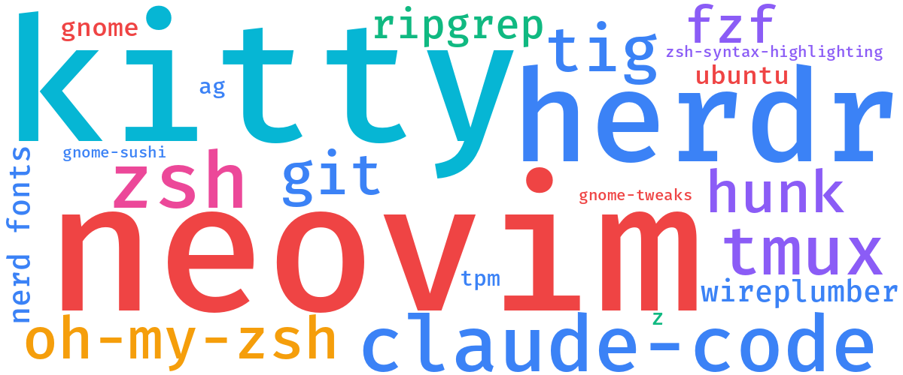

### dotfiles



### Start

1. Install the prerequisites: `sudo apt install git curl`
2. [Create an SSH key](https://docs.github.com/en/authentication/connecting-to-github-with-ssh/generating-a-new-ssh-key-and-adding-it-to-the-ssh-agent) and [add it to GitHub](https://github.com/settings/keys)
3. Clone to `~/dev/dotfiles` (`setup.sh` expects this path):
   ```sh
   git clone git@github.com:alextrastero/dotfiles.git ~/dev/dotfiles
   ```
4. Run the setup: `~/dev/dotfiles/setup.sh`
5. Log out and back in so zsh becomes the login shell
6. Install [neovim](https://github.com/neovim/neovim/releases/) and [nvm](https://github.com/nvm-sh/nvm#installing-and-updating), then node: `nvm install --lts`
7. Restore gnome settings: `envsubst '$HOME' < ~/dev/dotfiles/gnome_tweaks_settings.dconf | dconf load -f /`
8. Optional: install the GitHub CLI with [setup_gh_cli.md](setup_gh_cli.md)

### Manual installs

Not covered by `setup.sh`:

- [slack](https://slack.com/intl/en-gb/downloads/linux), set to start on login
- [brave-browser](https://brave.com/linux/)
- [google-chrome](https://www.google.com/chrome/)
- [color picker](https://extensions.gnome.org/extension/3396/color-picker/) gnome extension
- email client, set to start on login

## gnome-tweaks bckp

`gnome_tweaks_settings.dconf` holds a hand-picked subset of settings, not a full dump.
Paths use `$HOME`, which `envsubst` expands on restore.

```sh
  # restore
    envsubst '$HOME' < gnome_tweaks_settings.dconf | dconf load -f /
  # read current values for a section before copying them into the file
    dconf dump /org/gnome/desktop/interface/
```

## agent skills

`skills/<name>/SKILL.md`, shared by every coding agent. `setup.sh` links the dir to
`~/.claude/skills` (Claude Code, opencode) and `~/.omp/agent/skills` (omp).
`skills/synced/` is managed by Claude sync and gitignored.

## issues
- When starting vim if python3 provider warning run:
  - `$ python3 -m ensurepip --upgrade`
  - `$ python3 -m pip install --user --upgrade pynvim`
